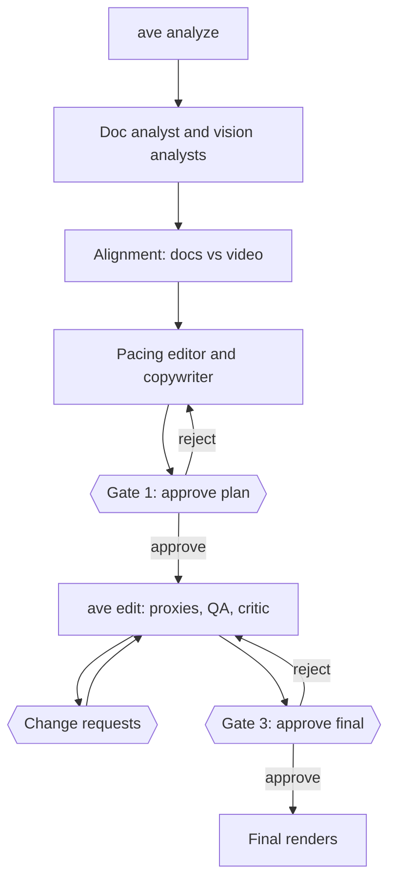

<div align="center">

# ai-video-editor (`ave`)

**Turn a software demo recording into short social videos, with you approving every step.**


[Features](#features) • [Getting started](#getting-started) • [How it works](#how-it-works) • [Configuration](#configuration) • [Writing an EDL](#writing-an-edl-by-hand) • [Tracing and cost](#tracing-and-cost) • [Development](#development)

</div>

`ave` reads your screen recording and your project docs, works out which features the video actually shows, and drafts an edit that fits the platform. It plans first, waits for your approval, and only then edits and exports. Nothing leaves the approved plan without you deciding on it.

## Features

- **Grounded in your docs.** A feature catalog is built from your Markdown and matched against what is on screen, so you can see what is shown, what is docs-only and where the two conflict.
- **Plan before pixels.** You review a storyboard and can approve it, send it back with feedback, or edit the plan file yourself.
- **Every word is checked.** Titles, captions, banners and a LinkedIn post are written in your voice, and each line cites the fact it rests on.
- **Editor's QA.** Automatic checks cover duration, flash cuts, caption reading time, zoom sharpness and text covering on-screen UI. A critic agent then reviews labeled frames from the proxies.
- **You stay in charge.** Any departure from the approved plan becomes a change request with 2–4 options for you to pick from.
- **Per-platform renders.** Reframing, safe zones, fast-forwards, zooms, animated start and end banners, loudness normalization and NVENC when available. Clips are cached, so changing one segment re-renders only that segment.
- **Observable.** Local or LangSmith traces, plus token usage per agent.

| Platform | Aspect | Size | Target length |
| --- | --- | --- | --- |
| `linkedin` | 16:9 | 1920×1080 | 45–60 s |
| `reels` | 9:16 | 1080×1920 | 30–45 s |
| `facebook` | 4:5 | 1080×1350 | 30–60 s |

## Getting started

### Prerequisites

- [uv](https://docs.astral.sh/uv/) and Python 3.13 or later
- [ffmpeg](https://ffmpeg.org/) 6 or later, with `ffprobe`
- [Claude Code](https://docs.claude.com/en/docs/claude-code/overview), logged in: the agents run on your own Claude subscription
- Optional: an NVIDIA GPU for NVENC encoding (falls back to libx264)

### Install

```bash
git clone <repository-url>
cd ai-video-editor
sudo apt install ffmpeg
uv sync --extra ocr      # OCR (rapidocr + onnxruntime); models download on first use
uv run ave doctor        # checks ffmpeg, GPU, credentials and optional dependencies
```

### Edit your first demo

```bash
uv run ave init --name "My Project" --video demo.mp4 --docs "docs/*.md" --platform linkedin --platform reels
uv run ave run           # opens Claude Code on /ave-edit for the latest run
```

Claude Code then drives the whole pipeline and stops at each approval gate. Finished videos land in `runs/<id>/out/`, one `<platform>.mp4` per platform, plus `linkedin.post.txt`.

> [!IMPORTANT]
> The defaults are set up for the author. Before your first run, change `brand.*` in `project.yaml`, and point `writing.skill` at your own Claude Code writing skill, or set it to `null`. See [Configuration](#configuration).

> [!TIP]
> Running `ave` with no command opens an interactive shell with tab completion and per-project history. The prompt shows the latest run and any gate it waits at (`ave r-0002 ⏸ plan_approval ▸`), and the shell prints the next step after each command.

## How it works

`ave` does the deterministic work: analysis, OCR, validation, rendering and export. Six Claude Code sub-agents do the reasoning, and the `/ave-edit` command orchestrates them through `ave` commands.



1. **Analyze.** `ave analyze` finds scene cuts, idle stretches, activity regions and silence, extracts keyframes and labeled contact sheets, runs OCR on on-screen text, and splits the docs into sections.
2. **Understand.** The doc analyst writes `catalog.json` (features, on-screen cues, claims, with doc citations). Vision analysts, one per chunk and in parallel, write `vision/<chunk>.json`.
3. **Align.** `ave align` finds each feature's cues in the OCR text, then the alignment agent writes `alignment.json`: shown, docs-only, conflict, plus video-only moments. View it with `ave coverage`.
4. **Plan.** The pacing editor drafts an EDL with notes, cuts and questions. The copywriter writes all text, which `ave copy apply copy.json` merges under length, citation and no-placeholder rules. `ave plan submit` stores the result.
5. **Gate 1.** Inspect with `ave plan show`, `ave storyboard` and `ave plan diff 1 2`. Then `ave plan approve`, or `ave plan reject -m "..."` to have the planner revise it.
6. **Edit.** `ave edit` renders half-res proxies and review sheets, and runs the automatic checks. The QA critic writes `edit/critic.json`. `ave qa show` lists everything.
7. **Change requests.** Agents prepare 2–4 options, each a full EDL or "keep as is", and `ave changes new` registers them. The run waits for `ave changes choose CR-01 B -m "why"`, or `--other "..."`. The previous edit is archived as `edit/edl.rN.json`.
8. **Gate 3.** `ave qa pass` is refused while a warning or error has not been put to you, unless you pass `--accept-risk "why"`. Then `ave final approve` renders the finals and closes the run, or `ave final reject -m "..."` sends it back to editing.

`ave resume` restarts a failed run from the phase it failed in.

Every agent output is checked with `ave validate <kind> FILE`: schema plus cross-file rules such as known feature ids and doc sections, ranges inside the video, the duration cap and existing sources. `ave schema <kind>` prints each format, and `ave context` prints a run's paths and state.

### The agents

`ave init` installs these into the project's `.claude/`, along with the `/ave-edit` command, async hooks that trace agent activity, and a permission rule allowing `Bash(ave:*)`.

| Agent | Output |
| --- | --- |
| `ave-doc-analyst` | Feature catalog from your docs |
| `ave-vision-analyst` | Report on one chunk of the recording |
| `ave-alignment` | Docs vs video coverage |
| `ave-pacing-editor` | Edit plan, revised from Gate 1 feedback |
| `ave-copywriter` | All on-screen text and the LinkedIn post |
| `ave-qa-critic` | Review of the proxy renders |

`ave agents` shows their status. `ave agents install` refreshes them and keeps your edits unless you pass `--force`.

## Configuration

`ave init` creates `project.yaml`. `ave` searches for it upward from the current directory, or you can point at a project with `-p/--project`.

```yaml
name: my-project
videos:
  - demo.mp4
docs:
  - docs/*.md
platforms: [linkedin, reels]
max_duration: 60.0              # hard cap in seconds, up to 600
brand:
  author_name: Your Name
  linkedin_url: https://www.linkedin.com/in/you
  primary_color: '#0A66C2'
  accent_color: '#F5F5F5'
  logo: null
  photo: null                   # round avatar on the end card
  font: null                    # bold .ttf/.otf for titles and banners
  font_regular: null            # .ttf/.otf for captions
writing:
  skill: your-writing-skill     # Claude Code skill the copywriter loads, or null
  linkedin_post: true
models:
  planner: opus                 # Claude Code alias or full model id
  worker: sonnet
observability:
  provider: local               # local | langsmith | none
ffmpeg:
  encoder: auto                 # auto | nvenc | cpu
```

Read and change values from the CLI:

```bash
uv run ave config get observability.provider
uv run ave config set platforms "[linkedin, reels]"
```

Secrets such as `LANGSMITH_API_KEY` can live in `~/.config/ave/env` (`KEY=value` lines, `chmod 600`). `ave` and its Claude Code hooks load that file without overriding your environment.

> [!NOTE]
> `inference.backend` accepts `claude_code` (the default) or `api`. Only `claude_code` runs the agents today. With `api`, `ave doctor` checks your Anthropic credentials, but `ave run` refuses to start.

## Writing an EDL by hand

An EDL (edit decision list) describes the whole edit: segments of the recording with speed, zooms and text, plus start and end banners. The agents write one for you, but you can also write your own and render it directly.

```bash
uv run ave probe demo.mp4                   # duration, size, fps, audio
uv run ave edl example > edl.yaml           # commented starting point
uv run ave edl validate edl.yaml            # timeline, duration vs cap, source checks
uv run ave preview proxy --edl edl.yaml     # half-res fast render, opens a player
uv run ave preview sheet --edl edl.yaml     # contact sheet of the render
uv run ave export --edl edl.yaml            # final videos, one per project platform
```

Output goes to `out/<edl name>/<platform>.mp4`, or `.proxy.mp4` for proxies.

<details>
<summary>EDL behavior</summary>

- Times are source seconds. Zoom boxes are 0..1 of the source frame.
- Fast-forwarded segments (speed >= 1.5) mute audio and show a speed badge by default.
- `reframe: fit` shows the whole recording on a blurred or brand-colored background when the platform aspect differs. `fill` crops to the canvas around `focus_x`.
- Titles and captions stay inside each platform's safe zone. Reels keeps clear of its UI.
- Banner text layers fade and rise in one after another. `hero: {source, at}` puts a blurred, brand-tinted frame of the recording behind them.
- The end card shows `brand.photo` (if set) as a round avatar, an "in" badge on the LinkedIn line and a `cta` pill.
- Clips are cached in `.ave/cache`.
- The encoder is NVENC when it works, otherwise libx264. Override with `ffmpeg.encoder` or `--encoder`.

</details>

## Tracing and cost

Set `observability.provider` in `project.yaml`:

- `local` (default): spans are written to `runs/<id>/trace.jsonl`.
- `langsmith`: the same spans plus LangSmith traces. Hooks turn a Claude Code session into a trace, traces from one run share a thread (`thread_id` is the run id), and approval decisions are attached as feedback. `observability.log_images` controls frames sent to LangSmith: `full`, `thumbnails` (default, 256px) or `none`.
- `none`: off.

```bash
uv run ave trace      # span tree of a run; --depth, --errors, --json, --links
uv run ave cost       # token usage per agent and model
```

`ave cost` reads the Claude Code transcripts of the sessions that worked on the run and adds an API-equivalent dollar estimate. On a subscription you pay for the plan, not per token.

## Development

```bash
uv run pytest -m "not ffmpeg and not ocr"   # unit tests (CI job "test")
uv run pytest -m "ffmpeg or ocr"            # real ffmpeg >= 6 and the ocr extra (CI job "test-ffmpeg")
uv run ruff check && uv run ruff format --check
```

CI is defined in [`.github/workflows/ci.yml`](.github/workflows/ci.yml). Throwaway scripts go in `tmp/`, which is gitignored.
